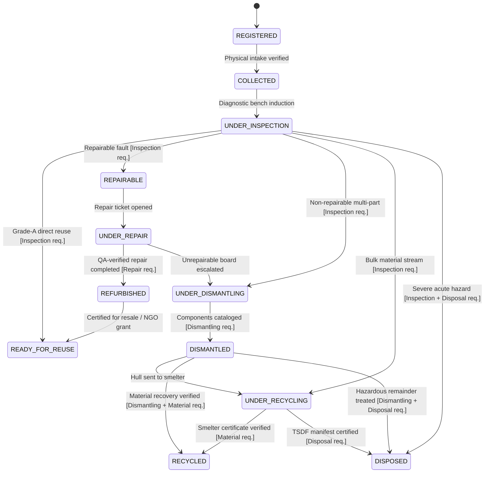

# ReLoop — Lifecycle State Machine, KPI Definitions & Business Rules

---

## 1. Device Lifecycle Finite State Machine (12 States)

---

## 2. Database-Enforced Invariants (PostgreSQL Triggers & Constraints)

1. **Initial State Invariant**: Every newly inserted `devices` row must start at `REGISTERED` (`trg_validate_device_lifecycle_transition`).
2. **Directed Graph Invariant**: Any `UPDATE` changing `devices.current_status` must match a `(from_status, to_status)` row in `lifecycle_transition_rules`, or PostgreSQL aborts with `SQLSTATE P0001`.
3. **Evidence Prerequisite Invariants**:
   - Post-inspection states (`REPAIRABLE`, `READY_FOR_REUSE`, `UNDER_DISMANTLING`, `UNDER_RECYCLING`, `DISPOSED`) require `EXISTS (SELECT 1 FROM inspections WHERE device_id = NEW.device_id)`.
   - `REFURBISHED` requires `EXISTS (SELECT 1 FROM repair_records WHERE device_id = NEW.device_id AND repair_status = 'COMPLETED' AND qa_verified = TRUE)`.
   - `DISMANTLED` requires `EXISTS (SELECT 1 FROM dismantling_records WHERE device_id = NEW.device_id)`.
   - `RECYCLED` requires `EXISTS (SELECT 1 FROM material_recovery_records WHERE source_device_id = NEW.device_id)`.
   - `DISPOSED` requires `EXISTS (SELECT 1 FROM disposal_records WHERE device_id = NEW.device_id)`.
4. **Immutable Ledger Invariant**: `lifecycle_events` cannot be updated or deleted (`trg_protect_immutable_lifecycle_events` raises `SQLSTATE P0002`).
5. **TSDF Hazardous Authorization Invariant**: `disposal_records` can only reference an active `recycling_facilities` row where `authorized_for_hazardous = TRUE` and `license_valid_until >= disposed_date` (`SQLSTATE P0003`).
6. **Component Lineage Invariant**: Every `recovered_components` row must match its parent `dismantling_records.device_id`, and any sub-component (`parent_recovered_component_id`) must belong to the same `source_device_id` (`SQLSTATE P0004`).

---

## 3. KPI Definitions (Preventing Double-Counting)

A classic pitfall in e-waste analytics is counting a dismantled laptop (`1 device`) PLUS its 4 recycled components (`4 components`) as `"5 recycled items"`. ReLoop strictly separates **Device-Level Outcomes**, **Component-Level Counts**, and **Mass-Based Material Yield**:

- **Terminally Processed Devices ($N_{\text{term}}$)**:
  $$N_{\text{term}} = \text{COUNT}(\text{devices}) \text{ WHERE current\_status IN ('REFURBISHED', 'READY\_FOR\_REUSE', 'RECYCLED', 'DISPOSED')}$$
- **Device Recycling Rate (%)**:
  $$\text{Recycling Rate} = \frac{\text{COUNT}(\text{devices WHERE current\_status = 'RECYCLED'})}{N_{\text{term}}} \times 100$$
- **Circular Economy Diversion Rate (%)** (Reuse + Refurbishment + Material Recycling vs Hazardous Disposal):
  $$\text{Circular Diversion Rate} = \frac{\text{COUNT}(\text{devices WHERE current\_status IN ('REFURBISHED','READY\_FOR\_REUSE','RECYCLED')})}{N_{\text{term}}} \times 100$$
- **Repair Success Rate (%)**:
  $$\text{Repair Success Rate} = \frac{\text{COUNT}(\text{repair\_records WHERE repair\_status = 'COMPLETED'})}{\text{COUNT}(\text{repair\_records WHERE repair\_status IN ('COMPLETED','UNREPAIRABLE\_ESCALATED')})} \times 100$$
- **Total Material Recovered (kg)**:
  $$\sum \text{material\_recovery\_records.recovered\_weight\_kg}$$

---

## 4. Role-Based Access Control (RBAC) Matrix

| Operation / Workflow | `ADMIN` | `COLLECTION_MANAGER` | `INSPECTOR` | `REPAIR_OPERATOR` | `RECYCLING_MANAGER` |
| :--- | :---: | :---: | :---: | :---: | :---: |
| View Dashboard, Traceability & Analytics | Yes | Yes | Yes | Yes | Yes |
| Register Collection Batch & New Device | Yes | Yes | No | No | No |
| Execute Diagnostic Inspection | Yes | No | Yes | No | No |
| Open & Resolve Repair / Refurbish Tickets | Yes | No | No | Yes | No |
| Execute Dismantling & Harvest Components | Yes | No | No | No | Yes |
| Record Material Recovery & TSDF Disposal | Yes | No | No | No | Yes |
| Refresh Materialized Views & Register Facilities | Yes | No | No | No | Yes |
